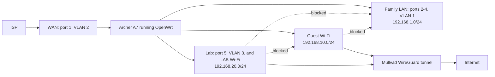

# homelab-docs
Practice lab for CompTIA A+, Network+, and Security+.

## Hardware
- Dell Inspiron 23 AIO (Proxmox VE host)
- TP-Link Archer A7 running OpenWrt

## Architecture

## What This Shows

- Segmented home network with separate family, guest, and lab networks
- VLAN configuration on a consumer router running OpenWrt
- Firewall zones and inter-zone policy
- Policy routing through a WireGuard VPN
- DNS and DHCP configuration

## Status

Network segmentation is complete. Proxmox VE host setup is next.

## Documentation

- [Router setup](docs/router-setup.md)
- [DNS migration](docs/dns-migration.md)

## Build log
- 2026-10-12: Home network segmentation complete. Lab host (Proxmox) setup pending. My home setup now has three separate networks: Family, Guest, and Lab. [Router setup](docs/router-setup.md)
- 2026-10-11: Updated DNS from Mullvad to Quad9. [DNS migration](docs/dns-migration.md)
