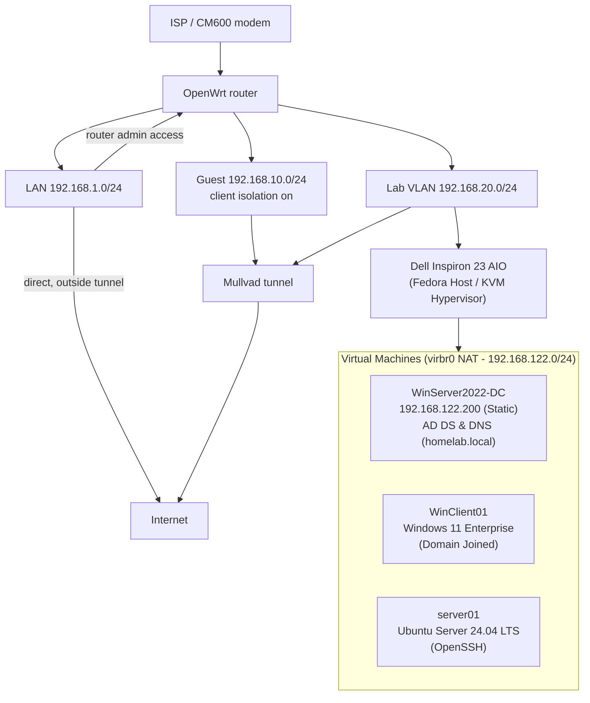

# homelab-docs

Multi-OS Systems Administration, Virtualization & Network Operations Lab

## Hardware
- Dell Inspiron 23 AIO (Fedora Workstation host / KVM hypervisor)
- TP-Link Archer A7 running OpenWrt
- Netgear CM600 cable modem

## Network Architecture

Logical view: the OpenWrt router segments LAN, Guest, and an isolated lab network. Guest and lab egress through a Mullvad WireGuard tunnel. The Dell AIO runs bare-metal Fedora with KVM/QEMU hosting guest virtual machines on an internal NAT bridge (`virbr0`).

## What This Shows

- **Physical Network Segmentation:** Isolated family, guest, and lab VLANs configured on OpenWrt
- **Security & Privacy:** Policy routing through a Mullvad WireGuard tunnel, client isolation, and Quad9 upstream DNS
- **Linux Paravirtualization:** Bare-metal Fedora host running KVM, QEMU, and `libvirt` with Red Hat VirtIO storage and network drivers
- **Identity & Access Management:** Windows Server 2022 Active Directory Domain Controller (`homelab.local`) with internal DNS
- **Enterprise Workstation Management:** Provisioned and joined Windows 11 Enterprise client to Active Directory
- **Troubleshooting:** Root-cause analysis and resolution of dynamic DHCP address collisions and APIPA fallback using native CLI tools
- **Headless Linux Administration:** Ubuntu Server 24.04 LTS provisioned with OpenSSH for centralized NOC monitoring

## Status

Active Directory domain infrastructure and KVM virtualization stack deployed. Next: deploying NOC monitoring services (Zabbix / Uptime Kuma) on `server01`.

## Documentation

- [KVM Hypervisor Setup](docs/kvm-hypervisor-setup.md)
- [Active Directory & Workstation Deployment](docs/active-directory-setup.md)
- [Router setup](docs/router-setup.md)
- [DNS migration](docs/dns-migration.md)
- [ISP modem replacement](docs/isp-modem-setup.md)

## Build log
- 2026-10-14: Migrated Dell AIO to Fedora Workstation host running native KVM/QEMU hypervisor. Provisioned Windows Server 2022 Active Directory Domain Controller (`homelab.local`), joined Windows 11 Enterprise client to domain, deployed headless Ubuntu Server 24.04 LTS, and resolved dynamic IP conflict via static subnet re-allocation. [KVM setup](docs/kvm-hypervisor-setup.md) | [AD setup](docs/active-directory-setup.md)
- 2026-10-12: Home network segmentation complete. Lab host setup pending. My home setup now has three separate networks: Family, Guest, and Lab. [Router setup](docs/router-setup.md)
- 2026-10-11: Updated DNS from Mullvad to Quad9. [DNS migration](docs/dns-migration.md)
- 2026-09-21: Replaced ISP modem/router with my own hardware. [ISP modem replacement](docs/isp-modem-setup.md)
