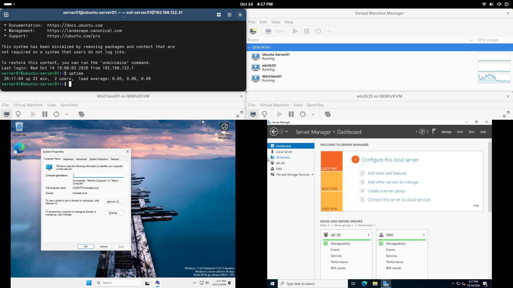

# Enterprise Hybrid Homelab & Network Operations
Hands-on infrastructure and operations lab covering physical network segmentation, Linux KVM virtualization, Active Directory Domain Services, continuous synthetic monitoring, OT/ICS telemetry, and service desk incident management.

## Hardware
- Dell Inspiron 23 AIO (Fedora Workstation host / KVM hypervisor)
- TP-Link Archer A7 running OpenWrt
- Netgear CM600 cable modem

## Network Architecture

Logical view: the OpenWrt router segments LAN, Guest, and an isolated lab network. Guest and lab egress through a Mullvad WireGuard tunnel. The Dell AIO runs bare-metal Fedora with KVM/QEMU hosting guest virtual machines on an internal NAT bridge (`virbr0`).

## What This Shows

- **Physical Network Segmentation:** Isolated family, guest, and lab VLANs configured on OpenWrt
- **Security & Privacy:** Policy routing through a Mullvad WireGuard tunnel, client isolation, and Quad9 upstream DNS
- **Linux Paravirtualization:** Bare-metal Fedora host running KVM, QEMU, and `libvirt` with Red Hat VirtIO storage and network drivers
- **Identity & Access Management:** Windows Server 2022 Active Directory Domain Controller (`homelab.local`) with internal DNS forwarders
- **Enterprise Workstation Management:** Provisioned and joined Windows 11 Enterprise client to Active Directory
- **Synthetic NOC Monitoring:** Uptime Kuma probing Layer 3 (ICMP) and Layer 4 (TCP DNS/Modbus ports) across the virtual bridge network
- **OT / Industrial Telemetry:** OpenPLC v3 soft-PLC container simulating Modbus TCP telemetry on port 502; frame dissection via Wireshark
- **Service Desk Incident Management:** Ticket lifecycle triage, alarm correlation, and runbook resolution documentation in osTicket
- **Systems Troubleshooting:** Non-disruptive online Linux LVM storage expansion (`lvextend`), API syntax updates, and dynamic IP collision resolution

## Status

Active Directory domain services, KVM virtualization stack, synthetic monitoring, and OT telemetry simulation are fully operational. All services fully documented with repeatable setup and verification runbooks.

## Documentation

- [OT Telemetry, Modbus TCP & Incident Lifecycle](docs/ot-telemetry-openplc-modbus.md)
- [Service Monitoring & Probing with Uptime Kuma](docs/service-monitoring-uptime-kuma.md)
- [Active Directory & Workstation Deployment](docs/active-directory-setup.md)
- [KVM Hypervisor Setup](docs/kvm-hypervisor-setup.md)
- [Router Setup & VLAN Segmentation](docs/router-setup.md)
- [DNS Migration](docs/dns-migration.md)
- [ISP Modem Replacement](docs/isp-modem-setup.md)

## Build Log
- 2026-10-15: Deployed containerized synthetic monitoring (Uptime Kuma) and industrial control simulation (OpenPLC v3) on `server01`. Performed live Linux LVM partition expansion (`lvextend`) under production disk constraints. Captured and dissected Modbus TCP MBAP headers and Function Code 03 query/response frames in Wireshark. Deployed osTicket and documented end-to-end incident triage and resolution runbook. [Monitoring setup](docs/service-monitoring-uptime-kuma.md) | [OT telemetry & ticketing](docs/ot-telemetry-openplc-modbus.md)
- 2026-10-14: Migrated Dell AIO to Fedora Workstation host running native KVM/QEMU hypervisor. Provisioned Windows Server 2022 Active Directory Domain Controller (`homelab.local`), joined Windows 11 Enterprise client to domain, deployed headless Ubuntu Server 24.04 LTS, and resolved dynamic IP conflict via static subnet re-allocation. [KVM setup](docs/kvm-hypervisor-setup.md) | [AD setup](docs/active-directory-setup.md)
- 2026-10-12: Home network segmentation complete. Lab host setup pending. My home setup now has three separate networks: Family, Guest, and Lab. [Router setup](docs/router-setup.md)
- 2026-10-11: Updated DNS from Mullvad to Quad9. [DNS migration](docs/dns-migration.md)
- 2026-09-21: Replaced ISP modem/router with my own hardware. [ISP modem replacement](docs/isp-modem-setup.md)
