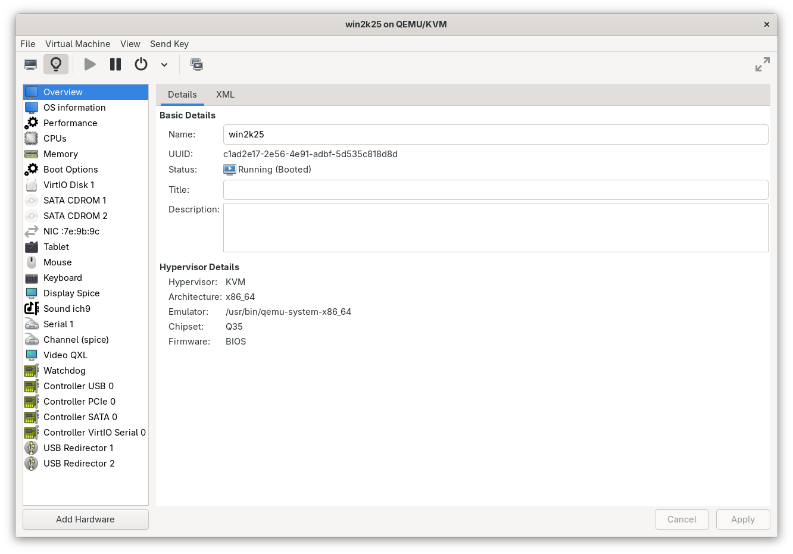
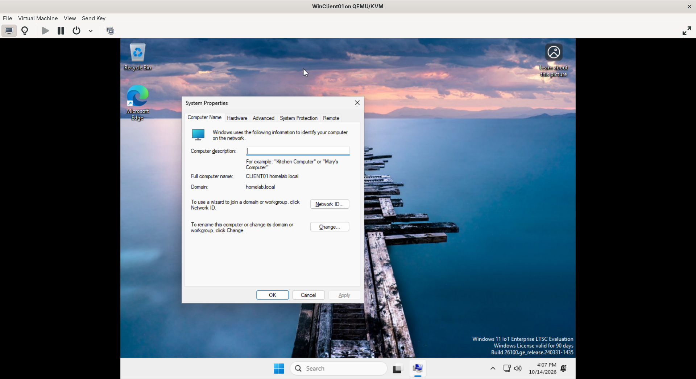

# Active Directory Domain Services & Workstation Deployment

## Objective
Establish an on-premises Active Directory Domain Services (AD DS) infrastructure on Windows Server 2022, configure enterprise static IP addressing and internal DNS resolution, and provision a Windows 11 Enterprise workstation joined to the domain.

---

## Environment Topology

| Hostname | Role / OS | IP Address | Subnet / Gateway | DNS Configuration |
| :--- | :--- | :--- | :--- | :--- |
| **DC01** | Domain Controller / Win Server 2022 | `192.168.122.200` (Static) | `255.255.255.0` / `192.168.122.1` | `127.0.0.1` (Self), `1.1.1.1` (Forwarder) |
| **CLIENT01** | Domain Workstation / Win 11 Enterprise | `192.168.122.x` (DHCP) | `255.255.255.0` / `192.168.122.1` | `192.168.122.200` (DC01) |
| **server01** | Infrastructure Monitor / Ubuntu 24.04 | `192.168.122.x` (DHCP) | `255.255.255.0` / `192.168.122.1` | `192.168.122.1` |

- **Root Domain:** `homelab.local`
- **Forest / Domain Functional Level:** Windows Server 2016 / 2022
- **Directory Services Restore Mode (DSRM):** Configured with dedicated recovery credentials

---

## 1. Domain Controller Provisioning

### A. Role Installation
1. Promoted clean Windows Server 2022 Datacenter Evaluation instance.
2. Renamed local server to `DC01`.
3. Added server roles via Server Manager:
   - **Active Directory Domain Services (AD DS)**
   - **DNS Server**
   - Management tools (Active Directory Administrative Center, AD Users and Computers, Group Policy Management Console).

### B. Forest Promotion
- Executed **"Promote this server to a domain controller"**.
- Selected **Add a new forest** with root domain `homelab.local`.
- Designated `DC01` as **Domain Name System (DNS) server** and **Global Catalog (GC)**.
- Validated prerequisites and finalized forest deployment.

---

## 2. Troubleshooting Case Study: IP Conflict & APIPA Fallback

During initial server configuration, a critical network addressing incident occurred and was diagnosed using standard troubleshooting workflows:

### Symptom
Following a reboot after initial role staging, `DC01` lost all external and internal network communications. Running `ipconfig` revealed an unexpected Automatic Private IP Addressing (APIPA) address:
```text
IPv4 Address . . . . . . . . . . . : 169.254.108.79
Subnet Mask  . . . . . . . . . . . : 255.255.0.0
Default Gateway  . . . . . . . . . :
```
## Root Cause Analysis
Running ipconfig /all showed the previously configured static IP address (192.168.122.10) flagged as:

IPv4 Address . . . . . . . . . . . : 192.168.122.10 (Duplicate)

During hypervisor initialization, KVM's virtual DHCP service dynamically leased 192.168.122.10 to another guest machine on the virtual bridge.
When Windows Server attempted to bind 192.168.122.10, RFC 5227 Gratuitous ARP detected another host using that IP on the collision/broadcast domain.
To protect the subnet from IP collision, Windows self-revoked the duplicate static address and defaulted to APIPA (169.254.0.0/16)

Remediation Workflow
```
Subnet Re-allocation: Reassigned DC01 to a reserved high-range IP well outside KVM's dynamic lease pool:
Static IP: 192.168.122.200
Subnet Mask: 255.255.255.0
Default Gateway: 192.168.122.1
Preferred DNS: 127.0.0.1 (loopback to internal AD DNS)
Alternate DNS: 1.1.1.1 (upstream forwarder)

Interface Reset:
cmd
netsh interface set interface "Ethernet" admin=disable
netsh interface set interface "Ethernet" admin=enable
```
Verification:
ipconfig /all confirmed static assignment without duplicate flags.
Outbound ICMP/DNS verified via ping 1.1.1.1 and nslookup.

## 3. Workstation Configuration & Domain Join

A. Client DNS Precedence
For a Windows workstation to locate Domain Controllers, its primary DNS must query the Active Directory DNS server hosting the _ldap._tcp.dc._msdcs.homelab.local SRV records:

- In WinClient01 IPv4 Properties (ncpa.cpl), configured Preferred DNS server: 192.168.122.200.
- Validated directory record discovery:
cmd
nslookup homelab.local

B. Machine Renaming & Domain Join

- Renamed factory machine identifier to standard workstation naming convention: CLIENT01.
- Initiated domain join via sysdm.cpl -> Member of Domain: homelab.local.
- Authenticated against DC01 using Domain Administrator credentials.
- Received domain join confirmation: "Welcome to the homelab.local domain."
- Restarted workstation and executed initial domain logon under HOMELAB\Administrator.

## 4. Verification & Screenshots

Initial Server Manager baseline dashboard	

Active Directory domain membership verified in System Properties 

Integrated enterprise lab overview (DC, Client, Linux Monitor)	


## 5. Technical Competencies Demonstrated

- Identity & Access Management: AD DS forest deployment, domain join operations, domain credential delegation.
- Enterprise Networking: Static IP scheme planning, TCP/IP stack configuration, DNS hierarchy, and APIPA fault isolation.
- Incident Troubleshooting: Analyzing duplicate IP conflicts via ipconfig /all, root-cause determination, and interface remediation using native CLI tools.


