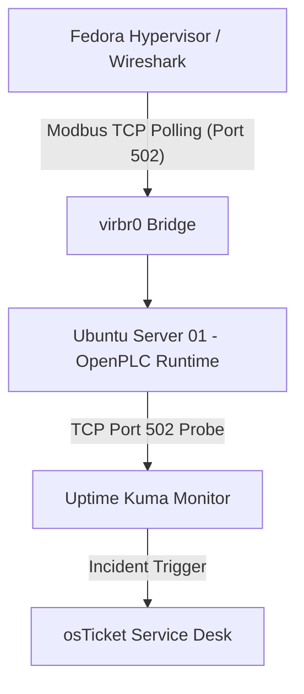
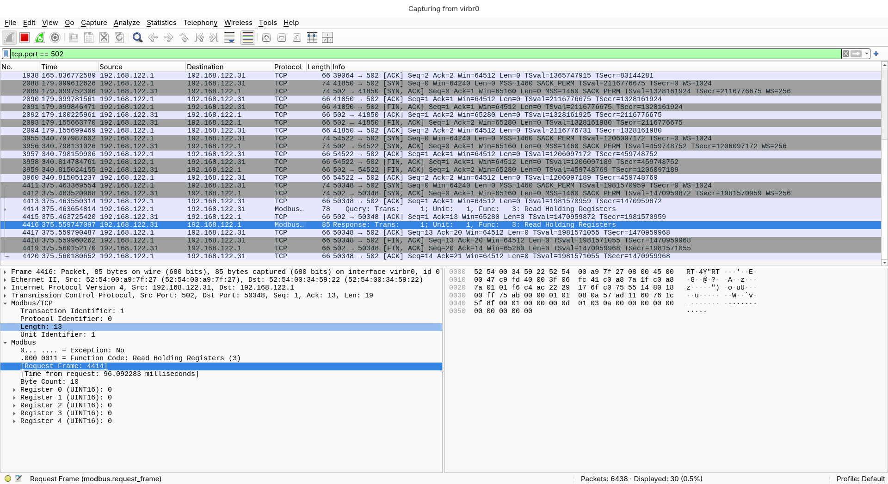
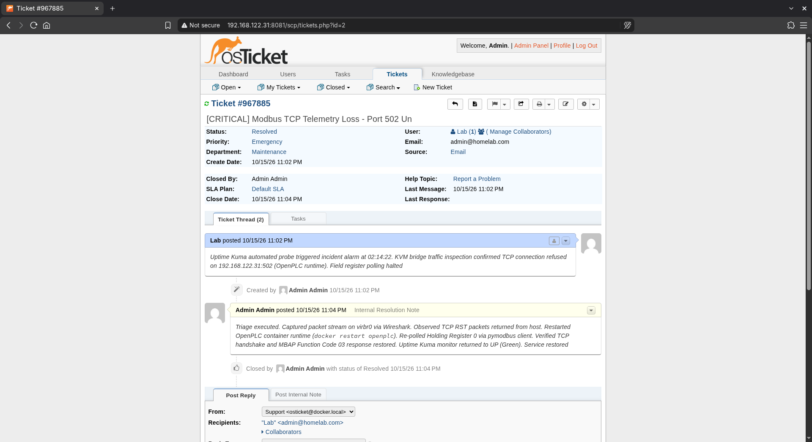

# OT Telemetry, Modbus TCP Packet Dissection & Incident Lifecycle

## 1. Overview & Objective
This lab bridges operational technology (OT) and enterprise IT networking. It deploys an open-source soft-PLC (OpenPLC v3) simulating industrial field telemetry over Modbus TCP, captures and dissects raw industrial protocol frames using Wireshark on the hypervisor virtual bridge, and executes a full incident resolution lifecycle in an enterprise ticketing system (osTicket).

---

## 2. Lab Architecture & Data Flow


- Runtime Target: OpenPLC container on server01 (192.168.122.31) listening on standard industrial Modbus TCP port 502.

- Interrogation Client: Python client on Fedora host issuing Function Code 03 (Read Holding Registers) queries across virbr0.

- Packet Analyzer: Wireshark attached to virbr0 filtering for mbtcp.

- Service Desk: osTicket instance managing incident intake, priority triage, and runbook resolution documentation.

## 3. Modbus TCP Protocol Analysis (Wireshark Dissection)

Capturing traffic on virtual bridge interface virbr0 reveals the transport and application layers of industrial telemetry:

**1. Transport Layer Handshake:**
- Client (192.168.122.1) initiates standard 3-way TCP handshake (SYN → SYN-ACK → ACK) with OpenPLC (192.168.122.31) on port 502.
  
**2. MBAP Header (Modbus Application Protocol):**
- Transaction Identifier: 2-byte field tracking request/response pairing.
- Protocol Identifier: 0x0000 (identifies standard Modbus protocol).
- Length: Number of following bytes in the frame.
- Unit Identifier: Slave device address (1).
  
**3. PDU (Protocol Data Unit) Payload:**
- Function Code: 03 (Read Holding Registers).
- Reference Number / Offset: Starting register address 0.
- Word Count: Number of 16-bit registers requested (5).
- Response Payload: 10 data bytes containing holding register values [0, 0, 0, 0, 0].
  
## 4. Engineering & Systems Troubleshooting
   
Online Linux Storage Expansion (LVM)
- Issue: During container layer extraction, Docker failed with failed to extract layer ... no space left on device.
- Diagnosis: Running df -h / revealed the root logical volume (ubuntu--vg-ubuntu--lv) was 94% utilized at 12 GB. Running sudo vgs confirmed that the default Ubuntu Server LVM installer only allocated a portion of the virtual drive, leaving unallocated space in the volume group.
- Resolution: Executed an online volume expansion without service interruption or filesystem unmounting:
```
sudo lvextend -l +100%FREE -r /dev/mapper/ubuntu--vg-ubuntu--lv
```
Verified immediate filesystem resize via df -h, restoring free capacity and allowing container deployments to complete successfully.

Client Interrogation Syntax
- Issue: Python Modbus query failed with TypeError: read_holding_registers() takes 2 positional arguments but 3 were given.
- Diagnosis: Modern PyModbus client API requires register count to be passed as an explicit keyword argument (count=N) rather than a positional integer.
- Resolution: Corrected query syntax:
```
python3 -c "from pymodbus.client import ModbusTcpClient; c = ModbusTcpClient('192.168.122.31', port=502); c.connect(); res = c.read_holding_registers(0, count=5); print(res.registers); c.close()"
```
## 5. Enterprise Incident Management Workflow (osTicket)
To model structured IT/OT operations, an incident was logged and resolved following standard service desk procedures:

**1. Incident Intake:**
- Ticket ID: #967885
- Priority: Emergency / High
- Summary: [CRITICAL] Modbus TCP Telemetry Loss - Port 502 Unreachable
- Source: Automated alarm correlation from Uptime Kuma probe failure.
  
**2. Root Cause Analysis & Resolution Runbook:**
- Isolated packet flow using Wireshark on virbr0 (observed connection refused / TCP RST).
- Executed container restart runbook: docker restart openplc.
- Re-polled holding register 0; verified clean TCP handshake and Function Code 03 response.
- Confirmed Uptime Kuma probe returned to Green (UP).
- Logged root-cause resolution notes and updated ticket status to Resolved.
  
## 6. Verification & Screenshots
Modbus TCP Packet Dissection
Wireshark frame analysis showing TCP port 502 transport, MBAP header fields, and Function Code 03 register query/response:

Wireshark Modbus Dissection


Closed-Loop Incident Resolution
osTicket Staff Control Panel showing prioritized telemetry outage ticket, runbook execution notes, and resolution documentation:

osTicket Incident Resolution


## 7. Technical Competencies Demonstrated
- OT/ICS Protocols: Modbus TCP architecture, MBAP headers, function codes, and holding register structures.
- Packet Analysis: Interrogating virtual hypervisor bridges with Wireshark to dissect unencrypted industrial protocols.
- Linux Systems Administration: Live LVM logical volume extension (lvextend) under production disk constraints.
- Service Desk Operations: Ticket lifecycle management, priority triage, and structured runbook documentation.


