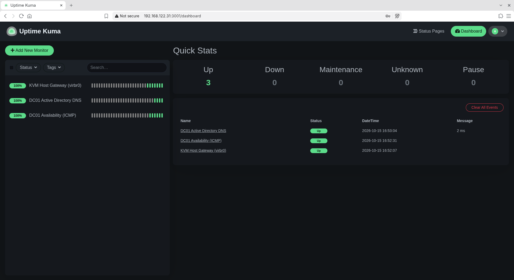
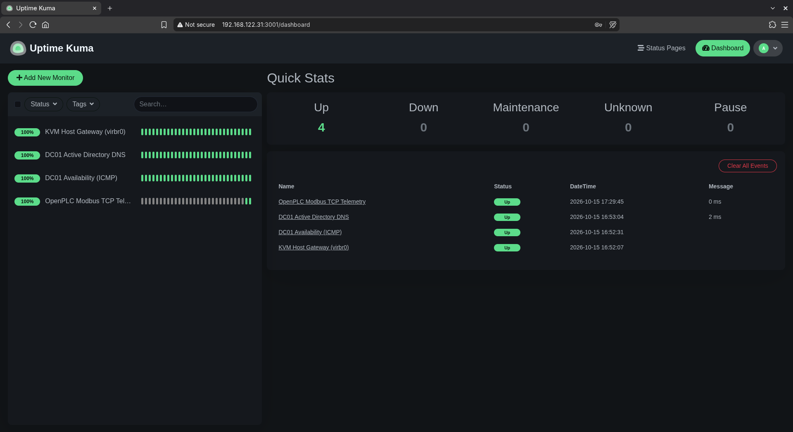

# Service Monitoring & Synthetic Probing with Uptime Kuma

## 1. Overview & Objective
This project establishes automated, synthetic service monitoring across the enterprise lab environment. Deployed as a lightweight containerized service on Ubuntu Server (`server01`), Uptime Kuma conducts periodic health checks against infrastructure nodes and services across the KVM virtual network bridge (`virbr0`).

The goal is to model proactive operations center monitoring—detecting service degradation and outages before end users report them.

---

## 2. Monitored Endpoints & Probe Configuration

| Friendly Name | Target Endpoint | Probe Type | Interval | Operational Purpose |
| :--- | :--- | :--- | :--- | :--- |
| **KVM Host Gateway** | `192.168.122.1` | ICMP Ping | 20s | Validates Layer 3 virtual bridge routing and host connectivity |
| **DC01 Host Availability** | `192.168.122.200` | ICMP Ping | 20s | Tracks Windows Server 2022 OS availability and network latency |
| **Active Directory DNS** | `192.168.122.200:53` | TCP Port | 20s | Verifies core Active Directory name resolution service |
| **OpenPLC Modbus Telemetry** | `192.168.122.31:502` | TCP Port | 20s | Monitors availability of industrial soft-PLC telemetry runtime |

---

## 3. Operational Translation: Plant DCS to Enterprise IT

Monitoring principles in an IT Operations / NOC environment directly mirror control room alarm management in industrial plants:

- **Field Transmitter Alarms Synthetic Probes:** In a DCS, transmitters continuously stream process variables against configured alarm limits. In IT, automated TCP/ICMP heartbeats continuously validate service state and latency boundaries.
- **Alarm Banners Incident States:** When a port fails the TCP 3-way handshake or exceeds latency thresholds, the status flips to an incident state, initiating alert dispatching and triage.
- **Shift Logs Uptime Metrics:** Continuous heartbeat tracking documents availability percentages, mean time between failures (MTBF), and mean time to resolution (MTTR).

---

## 4. Verification & Screenshots

### Baseline Infrastructure Monitoring
Validation of KVM virtual bridge gateway and Windows Server Domain Controller (ICMP + Port 53 DNS):

### Industrial Telemetry Integration
Active Layer 4 monitoring of OpenPLC Modbus TCP listener on port 502:

---

## 5. Technical Competencies Demonstrated
- **Synthetic Monitoring:** Implementing Layer 3 (ICMP) and Layer 4 (TCP SYN/ACK) health verification.
- **Infrastructure Triage:** Distinguishing between host-down (ICMP timeout) versus service-down (TCP port reset/refused) scenarios.
- **Container Deployment:** Deploying isolated monitoring tools via Docker with persistent data volumes.
